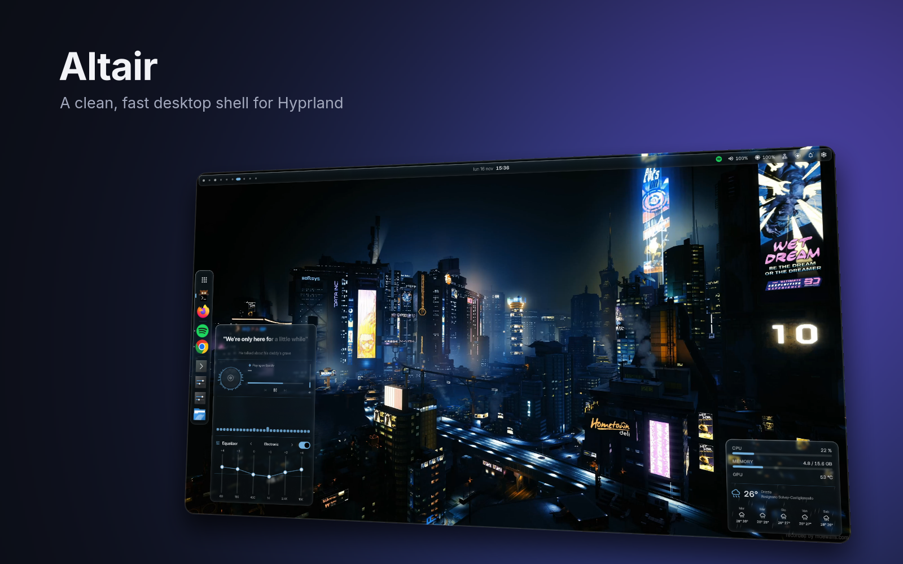
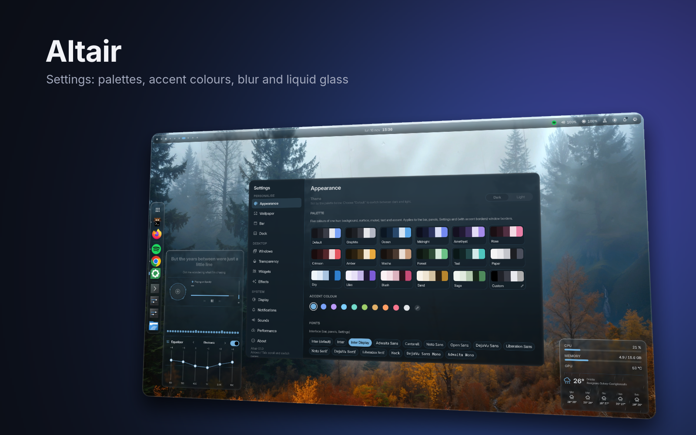

# Altair



A clean, fast desktop shell for [Hyprland](https://hypr.land), built with
[Quickshell](https://quickshell.org). Mostly monochrome with one accent colour,
frosted glass, smooth motion and close to zero CPU when idle.

> **Status:** v0.1. Small on purpose: fewer features, done well.
> Dashboard and lock screen are planned for v0.2.

## Screenshots




<sub>Regenerate with `docs/screenshots/make.sh` from raw 1920x1080 screenshots.</sub>

## Features

- **Bar**: workspaces (sliding indicator), clock, system tray with themed
  menus, volume, network, battery (laptops), notifications and settings.
  Top or bottom.
- **Dock** (optional, off by default): pinned apps and open windows at the
  bottom, left or right edge. Click to open or switch (again: next window),
  middle-click for a new window, right-click for the app's windows, its own
  actions (e.g. "New private window"), pin/unpin and close. Drag icons to
  reorder; drag a running app among the pinned ones to pin it. Recent / most
  used apps after a thin line (on by default). Auto-hide, icon size, pinning
  apps by search, and whether windows keep clear of it in *Settings → Dock*.
- **Desktop menu**: right-click the empty desktop to open an app or a
  terminal, change the wallpaper, edit widgets, record the screen, toggle
  Do not disturb / low-power mode, open Settings, restart Altair, or log
  out / restart / shut down (these need a second click to confirm).
- **Screen recorder**: a button in the bar records the screen you are on at
  60 fps, encoded on the graphics card (barely any CPU), with system sound
  (optionally the microphone too); click again to save to
  `~/Videos/Recordings`. Needs `gpu-screen-recorder`.
- **Calendar**: click the clock for a month calendar next to a round
  analogue clock (today highlighted, your locale's first weekday, optional
  ISO week numbers and seconds hand). Arrows, mouse wheel or
  Left/Right change the month; click the month name or press Home for today.
- **App launcher** (`SUPER + Space`): fuzzy search over names, descriptions
  and keywords; apps you use often rise to the top. The panel shrinks to the
  matches. Right-click an app (or press Menu / Shift+F10) for its actions
  (e.g. "New private window"), new window, pin to dock, copy its command.
- **Notifications**: popups with actions and images, a notification centre
  with history (`SUPER + N`), Do not disturb, optional sound.
- **Alt+Tab** window switcher: most recently used first, still previews (or
  app icons), switches workspace when needed. A quick tap jumps straight to
  the previous window without showing anything.
- **Desktop widgets** (`SUPER + D` to edit), up to 2 of each, frosted like
  the panels, on the desktop (above the wallpaper, below windows):
  clock (4 styles), round clock (4 styles), music (Card, spinning Disc,
  Cover, Minimal; drag the song bar to seek; the player's own volume;
  "Playing on Spotify"; any MPRIS player), visualizer (Bars, Mirror, Wave,
  Peaks, Circle; needs `cava`), **weather** (Card, Forecast, Hourly,
  Minimal; Open-Meteo, no account; optional rain / snow / storm / sun /
  fog effects), **lyrics** (Scroll, Focus, Karaoke (the line fills from grey to white as it is sung), Minimal; time-synced from LRCLIB when
  available), **equalizer** (16 presets + 6 bands you can
  drag, for the music player only, live; built on PipeWire's own filter, no
  extra daemon) and system (Bars,
  Rings, Compact: CPU, memory, optional GPU temperature). Drop a Visualizer
  or Equalizer next to a Music widget and it attaches like a magnet (top or
  bottom; left or right too with the Card and Disc styles); weather,
  clocks and system attach to any widget (e.g. weather under a round
  clock). Previewed live while dragging: one card that moves together and
  stays on screen as a whole (drag a part away to detach). Widgets glide
  out of the way when the bar or dock moves over them, and resize to what
  they show (e.g. without the GPU reading). Animated widgets pause while
  windows cover the desktop.
  Edit mode dims the screen and shows a dock to add widgets; drag to move
  (with the same smooth snapping, also to other widgets), drag the corner to
  resize, click a widget for its style, opacity and remove buttons. Several
  copies allowed; the layout is saved in `config.json`.
- **Wallpapers** (`SUPER + W`), drawn by Altair itself (no wallpaper daemon):
  - pictures (JPG, PNG, WebP, AVIF, JXL) and **live wallpapers** (MP4, WebM, MKV);
  - a carousel picker at the bottom, centre or top (hover or arrow keys to
    preview on the desktop, click to apply), or a grid;
  - cached thumbnails, crossfades, Fill / Fit;
  - live wallpapers pause while windows are open (or fullscreen, or never),
    with adjustable speed.
- **Settings app** (`SUPER + ,` or the gear in the bar):
  - dark / light, 16 five-colour palettes plus your own, accent colour with a
    colour picker;
  - blur and blur strength, *liquid glass*, animations, low-power mode;
  - window borders (accent / Hyprland / none), resize windows by dragging
    their edges, smooth resizing;
  - workspace switching animation (slide, vertical slide, fade, off or your
    own) and speed; the bar's workspace indicator moves in sync;
  - **snapping**: drag the Settings window by its sidebar or page title and
    it snaps to the screen edges, the centre lines and the bar (hold Shift to
    move freely), with the rest of the screen dimmed and guide lines shown;
    optional grid (4–16 px, applied on drop); its position is remembered per monitor and kept on
    screen. (Hyprland's own SUPER + drag does not snap: the shell cannot see
    it.)
  - **window transparency**: a default opacity for focused and other
    windows, plus per-app rules (focused / unfocused opacity, blur behind),
    with one-click suggestions (kitty, Spotify, Discord, Firefox, Dolphin)
    or any open window. Low-power mode keeps the opacity but turns the blur
    behind windows off;
  - keyboard navigation (arrows, Tab, Home/End);
  - live CPU and memory readout of the shell.
- **Safe with your Hyprland config**: Altair is loaded by one line; your
  `hyprland.lua` is never rewritten. Look changes (blur, borders, resizing,
  transparency, workspace animation) are applied at runtime (`hyprctl
  eval`: options and named window rules that live only in the running
  compositor) and your own values come back when you switch them
  off or uninstall.

### Panel backgrounds

*Settings → Effects → Panel backgrounds* adds a touch of colour from your
accent to panels, menus, Settings, the bar and the dock: **Glow** (soft
light from a corner, default), **Aurora** (three soft colour clouds) or
**Grain** (fine frosted texture). It is a static shader, drawn only when a
panel redraws anyway, so it costs nothing while idle; off in low-power mode.

### About "liquid glass"

The frosted background is real blur from the compositor. The gradient tint,
the bright edge and the inner glow are drawn by Altair on its own panels.
Real *refraction* (the background bending at the edges) isn't possible:
Hyprland only offers blur, not the actual pixels behind a window.

## Requirements

- An **Arch-based** distribution for `install.sh` (Arch, EndeavourOS, CachyOS, …).
  Other distributions: see [Manual install](#manual-install).
- **Hyprland 0.55 or newer** with the Lua config (`~/.config/hypr/hyprland.lua`).
- **Quickshell 0.3** or newer.

### Dependencies

Installed by `install.sh` (all from the official repositories):

| Package | Used for |
|---|---|
| `quickshell` | the shell toolkit |
| `qt6-multimedia`, `qt6-multimedia-ffmpeg` | live (video) wallpapers |
| `inter-font` | UI font |
| `ttf-material-symbols-variable` | icons |
| `pipewire`, `wireplumber` | volume |
| `libvips` | wallpaper thumbnails |
| `ffmpeg` | thumbnails and still frames of video wallpapers |
| `sound-theme-freedesktop` | notification sound |
| `xdg-utils` | opening folders (fallback) |

Optional: `networkmanager` (network status), `upower` (battery),
`libnotify` ("Send test" notification button), `gpu-screen-recorder` (screen recorder), `libpulse` (`pactl`, routes
the music player into the equalizer), `cava` (music visualizer
and Visualizer widget), `nvidia-utils` (GPU
temperature in the System widget; comes with the NVIDIA driver). The Music
widget works with any player that supports MPRIS.

## Install

```sh
git clone https://github.com/0kosmos/altair-shell
cd altair-shell
./install.sh --dry-run   # see what it would do; changes nothing
./install.sh
```

The installer:

1. lists missing packages and asks before running `sudo pacman -S --needed …`
   (the only time it uses `sudo`);
2. copies Altair to `~/.local/share/altair` and links it into
   `~/.config/quickshell/altair` and `~/.config/hypr/altair`. Anything already
   there that isn't Altair's is renamed, never deleted;
3. shows the one line it wants to add to `hyprland.lua`, makes a backup and
   asks first:
   ```lua
   require("altair").setup({ terminal = "kitty" })
   ```
4. reloads Hyprland and starts Altair.

Options: `--yes` (don't ask), `--dev` (link the checkout instead of copying,
for development), `--no-start`, `--uninstall`.

### Manual install

Install the dependencies above with your package manager, then:

```sh
ln -s "$PWD" ~/.config/quickshell/altair
ln -s "$PWD/hypr" ~/.config/hypr/altair
```

and add `require("altair").setup({ terminal = "your-terminal" })` to the end of
`~/.config/hypr/hyprland.lua`.

### Options for `setup()`

| Option | Default | Meaning |
|---|---|---|
| `terminal` | `$TERMINAL` or `kitty` | terminal for `SUPER + SHIFT + Return` |
| `mod` | `"SUPER"` | main modifier for Altair's keys |
| `autostart` | `true` | start Altair with Hyprland |
| `nvidia_egl_only` | `false` | on **NVIDIA-only** desktops: load only NVIDIA's EGL driver (saves ~100 MB). Don't use on laptops where an Intel/AMD GPU drives the screen. |
| `icon_theme` | your GTK icon theme | icon theme for apps and tray |
| `alttab` | `true` | the Alt+Tab switcher (`false` = leave ALT+Tab alone) |
| `launcher_key`, `notifications_key`, `wallpaper_key`, `settings_key`, `workspace_prev_key`, `workspace_next_key`, `last_workspace_key`, `widgets_key` | see below | other keys (e.g. `"SUPER + CTRL + H"`), or `false` for none |

## Keys

| Keys | Action |
|---|---|
| `SUPER + Space` | app launcher |
| `SUPER + W` | wallpaper picker |
| `SUPER + N` | notification centre |
| `SUPER + ,` | settings |
| `ALT + Tab` / `ALT + SHIFT + Tab` | window switcher (release ALT to switch, Escape to cancel) |
| `SUPER + D` | edit desktop widgets (Escape or Done to leave) |
| `SUPER + CTRL + Left` / `Right` | previous / next workspace |
| `SUPER + Tab` | back to the last-used workspace |
| `SUPER + SHIFT + R` | restart Altair |
| `SUPER + SHIFT + Return` | terminal (works even if Altair is down) |

The last two are defined in Hyprland itself, so they keep working if the shell
crashes or hangs.

## Configuration

Everything is in the Settings app. Settings are saved to
`~/.config/altair/config.json` (you can edit it by hand; changes apply live).

Altair can also be controlled from scripts or your own keybinds:

```sh
qs -c altair ipc show                                # everything available
qs -c altair ipc call panels toggle launcher         # launcher | notifications | wallpaper | calendar | settings
qs -c altair ipc call widgets toggleEdit           # desktop widgets' edit mode
qs -c altair ipc call recorder toggle              # start/stop screen recording
qs -c altair ipc call dock toggle                  # show/hide the dock
qs -c altair ipc call dock pin firefox -1          # pin an app (desktop id) at a position, -1 = end
qs -c altair ipc call dock peek                    # show an auto-hidden dock for 2 s
qs -c altair ipc call desktop menu                 # the desktop's right-click menu
qs -c altair ipc call wallpaper set ~/Pictures/Wallpapers/forest.jpg
qs -c altair ipc call settings setAccent '#7aa2f7'   # or "mono"
qs -c altair ipc call settings toggleLowPower
qs -c altair ipc call notifications toggleDnd
```

## Performance

Measured on an older desktop (2012 quad-core CPU, entry-level NVIDIA GPU):

| | CPU | Memory (PSS) |
|---|---|---|
| Idle, bar only | 0.00 % | ~160 MB |
| Launcher / settings open | 0–0.8 % | +20–35 MB |
| Dock shown | ~0 % (redraws only on hover and window changes) | +5–10 MB |
| Live wallpaper playing (separate process) | ~1.5 % of the whole CPU | +~400 MB |
| Live wallpaper paused | 0 % | +~370 MB |

Most of the base memory is the graphics driver. Live wallpapers run in their
own process that only exists while one is set; switching to a picture frees
that memory. Measure on your machine with `scripts/perf.sh 30`, or see
*Settings → Performance*.

## Troubleshooting

- **The shell is gone or frozen:** press `SUPER + SHIFT + R` to restart it, or
  `SUPER + SHIFT + Return` for a terminal and run `qs -c altair log`.
- **Logs:** `qs -c altair log` (add `-f` to follow).
- **Icons missing in the launcher:** set `icon_theme` in `setup()`.
- **Live wallpaper doesn't move:** by default it pauses while windows are open
  on screen (*Settings → Wallpaper → Pause when*).
- **Low on memory:** turn off live wallpapers, or use low-power mode.

## Uninstall

```sh
./install.sh --uninstall
```

Removes the links, `~/.local/share/altair` and the line in `hyprland.lua`
(backup first), and reloads Hyprland so your own look is back (this also
drops Altair's transparency rules). Your settings
(`~/.config/altair`), state and cache are kept; delete them yourself if you
like.

## Contributing

See [CONTRIBUTING.md](CONTRIBUTING.md).

## License

Altair is free software under the [GNU GPL v3 or later](LICENSE).
Third-party components and their licences are listed in [CREDITS.md](CREDITS.md).
