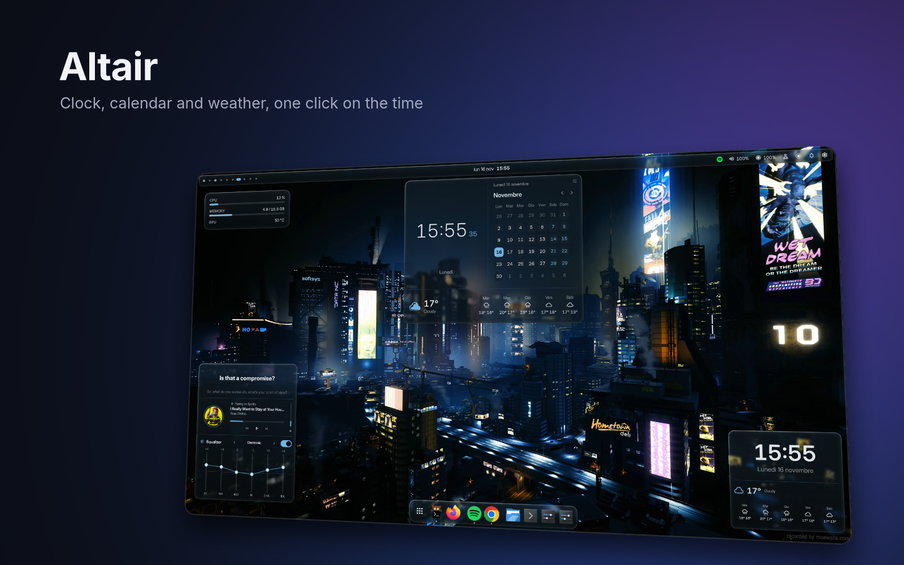
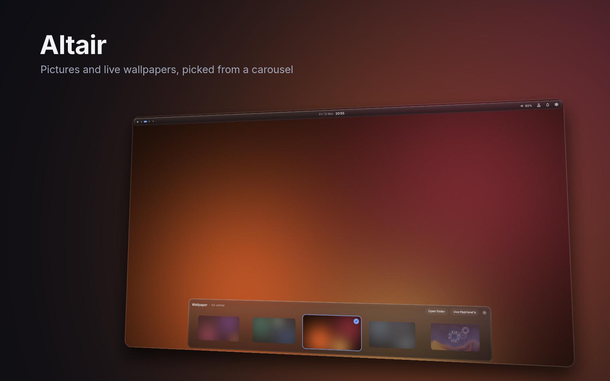
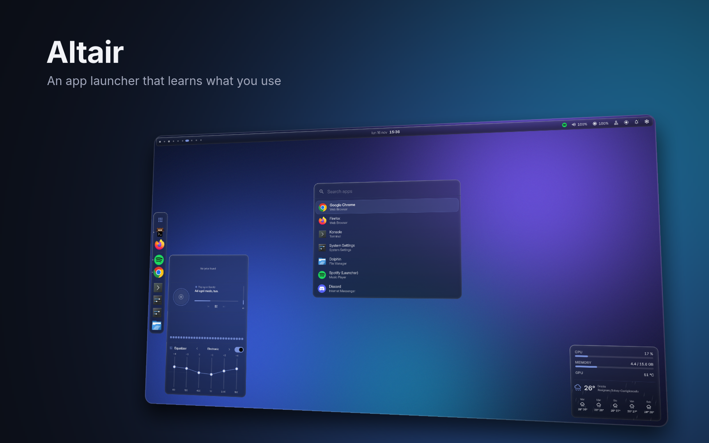
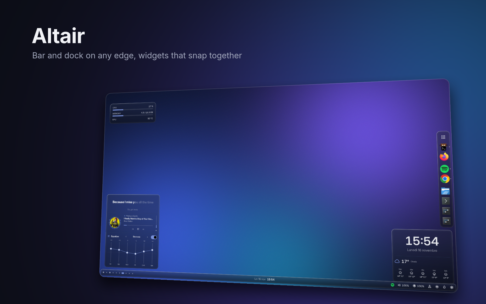
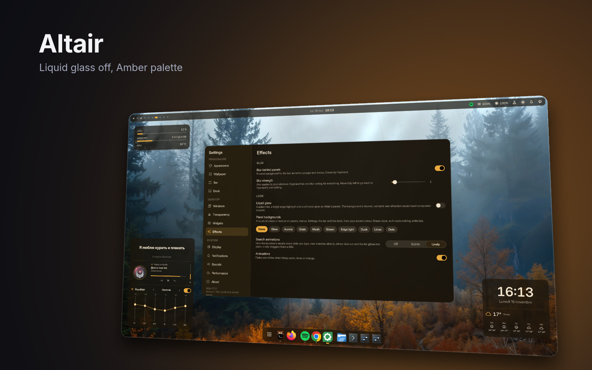
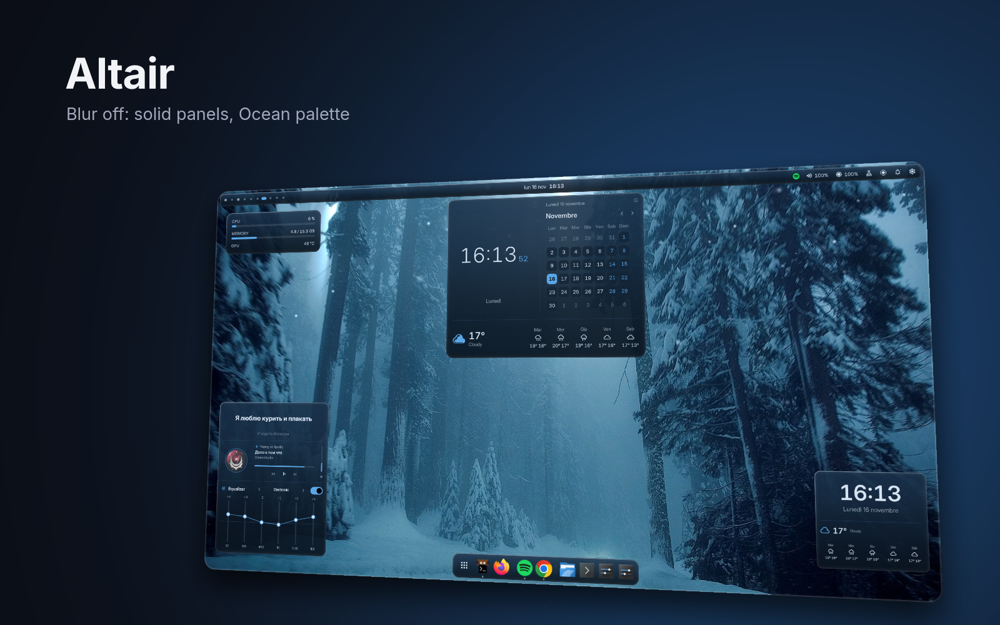

# Altair


A clean, fast desktop shell for [Hyprland](https://hypr.land), built with
[Quickshell](https://quickshell.org). Mostly monochrome with one accent colour,
frosted glass, smooth motion and close to zero CPU when idle.

> **Status:** v0.2: widgets, dock, Alt+Tab, sounds, network and display
> controls (see the [changelog](CHANGELOG.md)). v0.3 (in progress) adds a
> lock screen.

## Screenshots














<sub>Regenerate with `docs/screenshots/make.sh` from raw 1920x1080 screenshots.</sub>

## Features

- **Bar**: workspaces (sliding indicator), clock, system tray with themed
  menus, volume, network, Bluetooth, battery (laptops), notifications and
  settings. Top, bottom, left or right (a side bar stacks everything; the
  clock reads hours over minutes); set in *Settings → Bar*, or turn on
  "Move by dragging" there and drag the bar by an empty spot to another
  edge. The clock can sit in the middle or at either end.
- **Network menu** (click the network icon): the current connection with
  IP, gateway, DNS and MAC (click to copy), Wi-Fi on/off, nearby networks,
  connect with a password, disconnect, forget. Scans only while open.
- **Bluetooth menu** (shown when there is an adapter): on/off, your devices
  with battery level, connect/disconnect/forget, pair new devices nearby.
- **Brightness and colour**: a bar button like the volume one (scroll to
  change, click for brightness, night light and saturation) and
  *Settings → Display*. Hardware control where possible: the laptop
  backlight, or the monitor's own brightness, contrast, colour preset and
  RGB gain over DDC/CI (`ddcutil`). Saturation (digital vibrance), night
  light, gamma and extra dimming are a Hyprland screen shader that is only
  on while one of them is changed. Keys: `qs -c altair ipc call display
  up|down`; if colours ever look wrong: `… display resetColour` or
  `hyprctl reload`.
- **Dock** (optional, off by default): pinned apps and open windows at the
  bottom, left or right edge. Click to open or switch (again: next window),
  middle-click for a new window, right-click for the app's windows, its own
  actions (e.g. "New private window"), pin/unpin and close. Drag icons to
  reorder; drag a running app among the pinned ones to pin it. Recent / most
  used apps after a thin line (on by default). Auto-hide, icon size, pinning
  apps by search, and whether windows keep clear of it in *Settings → Dock*.
- **Volume and brightness pop-up**: a small frosted pill for a moment when
  the volume, mute, microphone mute or brightness changes, from your own
  keys (e.g. `wpctl` binds), other apps or the bar. Bottom or top
  (*Settings → Notifications*); clear of the bar and dock; exists only
  while shown. It reacts to changes, so a volume key at 100 % shows
  nothing (Altair's own brightness keys always show it).
- **Clipboard history** (opt-in, `SUPER + SHIFT + V`; needs `cliphist`):
  text and images you copied, newest first, with search and image
  thumbnails. Enter copies the entry and pastes it into the window you were
  in (Ctrl+Shift+V in terminals), Shift+Enter only copies, Delete removes
  one. Copies a password manager marks as secret are never stored. Turn it
  on and choose how many entries to keep in *Settings → Clipboard*.
- **Power menu** (`SUPER + Escape`, or the desktop menu): lock, suspend,
  hibernate (where available), log out, restart and shut down as large
  buttons over the blurred desktop. Arrow keys, Enter or the underlined
  letter (L, S, H, O, R, D). Log out, restart and shut down wait 5 s with a
  countdown ring that Esc, a click or Cancel stops (3 s or off in
  *Settings → Lock & power*). `ALTAIR_POWER_DRY_RUN=1` only logs, for
  testing.
- **Lock screen** (`SUPER + L`): your blurred wallpaper, the time, the
  song that's playing, and a password field with six typing animations
  (Pop, Wave, Glow, Shapes, Bars, Minimal; live preview in *Settings →
  Lock & power*). Locks after a set idle time (videos and games that keep
  the screen awake prevent it), before sleep, and on
  `loginctl lock-session`; turns the screen off while locked. Uses your
  normal login password through PAM (the system's `/etc/pam.d/login`
  rules; nothing is installed there). Built to never lock you out: see
  [If the lock screen breaks](#if-the-lock-screen-breaks).
- **Desktop menu**: right-click the empty desktop to open an app or a
  terminal, change the wallpaper, edit widgets, record the screen, toggle
  Do not disturb / low-power mode, open Settings, restart Altair, lock,
  or open the power menu.
- **Screen recorder**: left-click the bar's record button to record, again
  to save to `~/Videos/Recordings`; encoded on the graphics card (barely
  any CPU). Right-click it for the recorder menu: the whole screen or a
  region you drag (needs `slurp`), sound (none / system / + microphone),
  frame rate up to your monitor's refresh rate, quality, codec (only those
  your GPU can encode, e.g. H.264 / HEVC / AV1), mouse pointer, and your
  latest clips. Needs `gpu-screen-recorder`.
- **Calendar**: click the clock for a month calendar next to a clock
  (Classic, Minimal, Numbers, Dots, Digital) and the weather (a strip with
  the next days, or one line); the tune button switches styles. Round
  analogue clock (today highlighted, your locale's first weekday, optional
  ISO week numbers and seconds hand). Arrows, mouse wheel or
  Left/Right change the month; click the month name or press Home for today.
- **App launcher** (`SUPER + Space`): fuzzy search over names, descriptions
  and keywords; apps you use often rise to the top. The panel shrinks to the
  matches, which slide in and glide into place as you type (Search
  animations: Off / Subtle / Lively in *Settings → Effects*). Right-click an app (or press Menu / Shift+F10) for its actions
  (e.g. "New private window"), new window, pin to dock, copy its command.
- **Notifications**: popups with actions and images, a notification centre
  with history (`SUPER + N`), Do not disturb, optional sound.
- **UI sounds** (*Settings → Sounds*): short, soft sounds for notifications,
  opening/closing panels, clicks, switches, slider drags (the tick rises with
  the value), typing in the launcher, volume changes, widget edit mode and
  snapping. Ten built-in families (Glass, Soft, Minimal, Bubble, Wood,
  Pulse, Retro, Bell, Mechanical, Sci-fi) or your own file per event, a preview button for each, one master volume. Only
  notifications are on by default; low-power mode silences everything.
  Played by `pw-play`, so they cost nothing while quiet.
- **Alt+Tab** window switcher: most recently used first, still previews (or
  app icons), switches workspace when needed. A quick tap jumps straight to
  the previous window without showing anything.
- **Desktop widgets** (`SUPER + D` to edit), up to 2 of each, frosted like
  the panels, on the desktop (above the wallpaper, below windows):
  clock (6 styles), round clock (4 styles), music (Card, spinning Disc,
  Cover, Minimal; drag the song bar to seek; the player's own volume;
  "Playing on Spotify"; any MPRIS player), visualizer (Bars, Mirror, Wave,
  Peaks, Circle; needs `cava`), **weather** (Card, Forecast, Hourly,
  Minimal, Big; Open-Meteo, no account; optional rain / snow / storm / sun /
  fog effects), **lyrics** (Scroll, Focus, Karaoke (the line fills from grey to white as it is sung), Minimal; time-synced from LRCLIB when
  available), **equalizer** (16 presets + 6 bands you can
  drag, for the music player only, live; built on PipeWire's own filter, no
  extra daemon) and system (Bars,
  Rings, Compact, Graph: CPU, memory, optional GPU temperature). Widgets
  can use their own font (*Settings → Appearance → Fonts*). Drop a Visualizer
  or Equalizer next to a Music widget and it attaches like a magnet (top or
  bottom; left or right too with the Card and Disc styles); weather,
  clocks and system attach to any widget (e.g. weather under a round
  clock). Previewed live while dragging: one card that moves together and
  stays on screen as a whole (drag a part away to detach); opacity is
  shared by the whole group. **Right-click a widget** for its menu: style,
  visualizer (music), opacity, edit widgets, detach, widget settings,
  remove. Widgets glide
  out of the way when the bar or dock moves over them, and resize to what
  they show (e.g. without the GPU reading). Animated widgets pause while
  windows cover the desktop.
  Edit mode dims the screen and shows a dock to add widgets, with a
  toolbar: widget settings, Select (pick several to move or delete
  together), Undo, Redo, Clear all, Move panel (to another edge); drag to move
  (with the same smooth snapping, also to other widgets), drag the corner to
  resize, click a widget for its style, opacity and remove buttons. Several
  copies allowed; the layout is saved in `config.json`.
- **Themes with wallpapers**: the picker has a theme row: every palette,
  plus **Auto** (a palette generated from the wallpaper's colours, no extra
  tools). Save a theme for this wallpaper or for all; *On change* decides
  what switching wallpapers does: keep the theme, use the saved one, or
  Auto (saved first, else generated). IPC: `wallpaper autoTheme`.
- **Wallpapers** (`SUPER + W`), drawn by Altair itself (no wallpaper daemon):
  - pictures (JPG, PNG, WebP, AVIF, JXL) and **live wallpapers** (MP4, WebM, MKV);
  - a carousel picker at the bottom, centre or top (hover or arrow keys to
    preview on the desktop, click to apply), or a grid; **All / Pictures /
    Live** tabs and search (just type while the picker is open; Esc clears);
  - cached thumbnails, crossfades, Fill / Fit;
  - live wallpapers pause while windows are open (or fullscreen, or never),
    with adjustable speed.
  - five wallpapers of its own come with it (Aurora, Dusk, Lagoon, Ember,
    Glacier), put into `~/Pictures/Wallpapers` by install.sh.
- **Settings app** (`SUPER + ,` or the gear in the bar):
  - dark / light, 16 five-colour palettes plus your own, accent colour with a
    colour picker;
  - corners: square to very round (presets or a slider) for every panel,
    menu, card, the bar, dock, widgets and Settings, optionally Hyprland's
    window corners too;
  - blur and blur strength, *liquid glass*, animations, low-power mode;
  - window borders (accent / Hyprland / none), resize windows by dragging
    their edges, smooth resizing;
  - workspace switching animation (slide, vertical slide, fade, slide + fade,
    vertical + fade, bouncy, smooth, off or your own) and speed; the bar's
    workspace indicator moves in sync, on the same curve;
  - **snapping**: drag the Settings window by its sidebar or page title and
    it snaps to the screen edges, the centre lines and the bar (hold Shift to
    move freely), with the rest of the screen dimmed and guide lines shown;
    optional grid (4–16 px, applied on drop); its position is remembered per monitor and kept on
    screen. (Hyprland's own SUPER + drag does not snap: the shell cannot see
    it.)
  - **window transparency**: a default opacity for focused and other
    windows, plus per-app rules (focused / unfocused opacity, blur behind),
    with one-click suggestions (kitty, Spotify, Discord, Firefox, Dolphin)
    or any open window. Low-power mode keeps the opacity but turns the blur
    behind windows off;
  - keyboard navigation (arrows, Tab, Home/End);
  - live CPU and memory readout of the shell.
- **Safe with your Hyprland config**: Altair is loaded by one line; your
  `hyprland.lua` is never rewritten. Look changes (blur, borders, resizing,
  transparency, workspace animation) are applied at runtime (`hyprctl
  eval`: options and named window rules that live only in the running
  compositor) and your own values come back when you switch them
  off or uninstall.

### Panel backgrounds

*Settings → Effects → Panel backgrounds* adds colour, texture or motion
to panels and menus (with a live preview).

Still: **Glow** (soft light from a corner, default), **Aurora** (three soft
colour clouds), **Grain** (fine frosted texture), **Mesh** (four colour
corners), **Sheen** (a glossy light band), **Edge light** (accent light along
the top), **Dusk** (accent fading into a warmer hue), **Lines** (fine
pinstripes) or **Dots** (a faint dot grid).

Moving: **Flow** (drifting colour clouds), **Nebula** (soft mist),
**Waves**, **Prism** (an iridescent sweep), **Stars** (twinkling) and
**Pulse** (breathing edge light), **Lava** (merging blobs), **Ripple**
(rings from a corner), **Snow** and **Plasma**. They move only while a panel,
menu or Settings is open (30 fps, about 8–11 % of one core on an old CPU);
the bar and dock show them still, so they cost nothing while idle.

Options: intensity, colours (shades of the accent or your palette's
colours), animation on/off and speed, and **panel motion** — how panels,
menus and Settings open and close: Glide, Spring, Zoom, Drop, Fade, Pop,
Flip, Unfold or Swing. All off in low-power mode.

### About "liquid glass"

The frosted background is real blur from the compositor. The gradient tint,
the bright edge and the inner glow are drawn by Altair on its own panels.
Real *refraction* (the background bending at the edges) isn't possible:
Hyprland only offers blur, not the actual pixels behind a window.

## Requirements

- An **Arch-based** distribution for `install.sh` (Arch, EndeavourOS, CachyOS, …).
  Other distributions: see [Manual install](#manual-install).
- **Hyprland 0.55 or newer** with the Lua config (`~/.config/hypr/hyprland.lua`).
- **Quickshell 0.3** or newer.

### Dependencies

Installed by `install.sh` (all from the official repositories):

| Package | Used for |
|---|---|
| `quickshell` | the shell toolkit |
| `qt6-multimedia`, `qt6-multimedia-ffmpeg` | live (video) wallpapers |
| `inter-font` | UI font |
| `ttf-material-symbols-variable` | icons |
| `pipewire`, `wireplumber` | volume, UI sounds (`pw-play`) |
| `libvips` | wallpaper thumbnails |
| `ffmpeg` | thumbnails and still frames of video wallpapers |
| `sound-theme-freedesktop` | notification sound |
| `xdg-utils` | opening folders (fallback) |

Optional: `networkmanager` (network status and menu), `bluez` (Bluetooth
menu; enable it with `sudo systemctl enable --now bluetooth`), `ddcutil`
(monitor brightness over DDC/CI; needs the `i2c-dev` module), `upower` (battery),
`libnotify` ("Send test" notification button), `gpu-screen-recorder` (screen recorder), `cliphist` + `wl-clipboard` (clipboard history), `slurp` (record a region), `libpulse` (`pactl`, routes
the music player into the equalizer), `cava` (music visualizer
and Visualizer widget), `nvidia-utils` (GPU
temperature in the System widget; comes with the NVIDIA driver). The Music
widget works with any player that supports MPRIS.

## Install

```sh
git clone https://github.com/0kosmos/altair-shell
cd altair-shell
./install.sh --dry-run   # see what it would do; changes nothing
./install.sh
```

The installer:

1. lists missing packages and asks before running `sudo pacman -S --needed …`
   (the only time it uses `sudo`);
2. copies Altair to `~/.local/share/altair` and links it into
   `~/.config/quickshell/altair` and `~/.config/hypr/altair`. Anything already
   there that isn't Altair's is renamed, never deleted;
3. shows the one line it wants to add to `hyprland.lua`, makes a backup and
   asks first:
   ```lua
   require("altair").setup({ terminal = "kitty" })
   ```
4. reloads Hyprland and starts Altair.

Options: `--yes` (don't ask), `--dev` (link the checkout instead of copying,
for development), `--no-start`, `--uninstall`.

### Manual install

Install the dependencies above with your package manager, then:

```sh
ln -s "$PWD" ~/.config/quickshell/altair
ln -s "$PWD/hypr" ~/.config/hypr/altair
```

and add `require("altair").setup({ terminal = "your-terminal" })` to the end of
`~/.config/hypr/hyprland.lua`.

### Options for `setup()`

| Option | Default | Meaning |
|---|---|---|
| `terminal` | `$TERMINAL` or `kitty` | terminal for `SUPER + SHIFT + Return` |
| `mod` | `"SUPER"` | main modifier for Altair's keys |
| `autostart` | `true` | start Altair with Hyprland |
| `nvidia_egl_only` | `false` | on **NVIDIA-only** desktops: load only NVIDIA's EGL driver (saves ~100 MB). Don't use on laptops where an Intel/AMD GPU drives the screen. |
| `icon_theme` | your GTK icon theme | icon theme for apps and tray |
| `alttab` | `true` | the Alt+Tab switcher (`false` = leave ALT+Tab alone) |
| `brightness_keys` | `false` | brightness keys through Altair (works for external monitors too); leave off if your config binds them to `brightnessctl` |
| `launcher_key`, `notifications_key`, `wallpaper_key`, `settings_key`, `workspace_prev_key`, `workspace_next_key`, `last_workspace_key`, `widgets_key`, `lock_key`, `power_key`, `clipboard_key` | see below | other keys (e.g. `"SUPER + CTRL + H"`), or `false` for none |

## Keys

| Keys | Action |
|---|---|
| `SUPER + Space` | app launcher |
| `SUPER + W` | wallpaper picker |
| `SUPER + N` | notification centre |
| `SUPER + ,` | settings |
| `ALT + Tab` / `ALT + SHIFT + Tab` | window switcher (release ALT to switch, Escape to cancel) |
| `SUPER + D` | edit desktop widgets (Escape or Done to leave) |
| `SUPER + CTRL + Left` / `Right` | previous / next workspace |
| `SUPER + Tab` | back to the last-used workspace |
| `SUPER + L` | lock the screen |
| `SUPER + Escape` | power menu |
| `SUPER + SHIFT + V` | clipboard history (when turned on) |
| `SUPER + SHIFT + R` | restart Altair (also on the lock screen: it comes back locked) |
| `SUPER + SHIFT + Return` | terminal (works even if Altair is down) |

The last two are defined in Hyprland itself, so they keep working if the shell
crashes or hangs. `setup()` also turns on Hyprland's
`misc.allow_session_lock_restore`, so a restarted shell can take over a lock
screen that crashed.

## Configuration

Everything is in the Settings app. Settings are saved to
`~/.config/altair/config.json` (you can edit it by hand; changes apply live).

Altair can also be controlled from scripts or your own keybinds:

```sh
qs -c altair ipc show                                # everything available
qs -c altair ipc call panels toggle launcher         # launcher | notifications | wallpaper | calendar | power | clipboard | settings
qs -c altair ipc call widgets toggleEdit           # desktop widgets' edit mode
qs -c altair ipc call recorder toggle              # start/stop screen recording
qs -c altair ipc call dock toggle                  # show/hide the dock
qs -c altair ipc call dock pin firefox -1          # pin an app (desktop id) at a position, -1 = end
qs -c altair ipc call dock peek                    # show an auto-hidden dock for 2 s
qs -c altair ipc call desktop menu                 # the desktop's right-click menu
qs -c altair ipc call wallpaper set ~/Pictures/Wallpapers/forest.jpg
qs -c altair ipc call settings setAccent '#7aa2f7'   # or "mono"
qs -c altair ipc call settings toggleLowPower
qs -c altair ipc call notifications toggleDnd
qs -c altair ipc call lock lock                     # lock the screen (or: loginctl lock-session)
```

## Performance

Measured on an older desktop (2012 quad-core CPU, entry-level NVIDIA GPU):

| | CPU | Memory (PSS) |
|---|---|---|
| Idle, bar only | 0.00 % | ~160 MB |
| Launcher / settings open | 0–0.8 % | +20–35 MB |
| Dock shown | ~0 % (redraws only on hover and window changes) | +5–10 MB |
| Live wallpaper playing (separate process) | ~1.5 % of the whole CPU | +~400 MB |
| Live wallpaper paused | 0 % | +~370 MB |
| Volume/brightness pop-up | ~0 % hidden (no window); ~12 % while a key is held | only while shown |
| Lock screen shown | 0 % (the clock redraws once a minute) | only while locked |

Most of the base memory is the graphics driver. Live wallpapers run in their
own process that only exists while one is set; switching to a picture frees
that memory. Measure on your machine with `scripts/perf.sh 30`, or see
*Settings → Performance*.

## Troubleshooting

- **The shell is gone or frozen:** press `SUPER + SHIFT + R` to restart it, or
  `SUPER + SHIFT + Return` for a terminal and run `qs -c altair log`.
- **Logs:** `qs -c altair log` (add `-f` to follow).
- **Icons missing in the launcher:** set `icon_theme` in `setup()`.
- **Live wallpaper doesn't move:** by default it pauses while windows are open
  on screen (*Settings → Wallpaper → Pause when*).
- **Low on memory:** turn off live wallpapers, or use low-power mode.

### If the lock screen breaks

The lock screen is built so that you can always get back in:

- **A wrong password never unlocks**, and every attempt goes through the
  system's own rules. On most distributions **3 wrong passwords in a row
  lock the account for 10 minutes** (`pam_faillock`, also on the console).
  To lift it early, log in as root on a console and run
  `faillock --user <you> --reset`.
- **The lock screen froze or vanished** (Hyprland shows "the lockscreen
  app died" or a plain colour): press `SUPER + SHIFT + R`. Altair restarts
  and shows the lock screen again; the session stays locked in between.
- **Nothing helps:** press `Ctrl + Alt + F3`, log in with your user name and
  password, and unlock the Hyprland session:

  ```sh
  loginctl unlock-sessions      # all your sessions; may ask for your password
  # or, without admin rights: find Hyprland's session ID and unlock just that
  loginctl list-sessions
  loginctl unlock-session <ID>
  ```

  Go back with `Ctrl + Alt + F1` or `F2` (wherever Hyprland runs). If the
  lock screen is still there, Altair isn't running: start it from the
  console (it comes back locked), then unlock again:

  ```sh
  hyprctl --instance 0 eval 'hl.exec_cmd(require("altair").restart_cmd)'
  sleep 3; loginctl unlock-sessions
  ```

  (A session lock only ends when a lock screen ends it, so Altair has to be
  running. Last resort: `hyprctl --instance 0 dispatch 'hl.dsp.exit()'`
  ends the Hyprland session; unsaved work in open apps is lost.)
- **The password check itself is broken** (e.g. after a system update):
  the lock screen says so instead of freezing. While Altair 0.3 is in
  testing it also offers an *Unlock* button in that case only; that button
  will be removed before the release.

## Uninstall

```sh
./install.sh --uninstall
```

Removes the links, `~/.local/share/altair` and the line in `hyprland.lua`
(backup first), and reloads Hyprland so your own look is back (this also
drops Altair's transparency rules). Your settings
(`~/.config/altair`), state and cache are kept; delete them yourself if you
like.

## Contributing

See [CONTRIBUTING.md](CONTRIBUTING.md).

## License

Altair is free software under the [GNU GPL v3 or later](LICENSE).
Third-party components and their licences are listed in [CREDITS.md](CREDITS.md).
